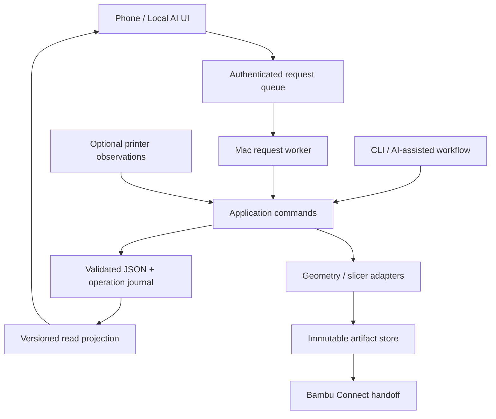

# Print Lab
## Product requirements, system design, evidence recovery and delivery blueprint

**Prepared for Bill • 26 October 2026 • Design proposal v1.0**

**Mission:** turn a physical printing problem into a traceable observation, a defensible next decision, and a repeatable usable part.

**Figma:** https://www.figma.com/design/ZDNyoPD0ZQRLEWw6NtmFPi

This is a specification for an incremental improvement of the existing project, not a claim that the proposed capabilities have been implemented. Figma examples are explicitly illustrative. No printer settings, experimental observations, production records or repository code were changed to prepare this document.

## 1. Executive decision

Keep the current Python engine, Bambu Studio adapter, Mac-owned JSON records and Local AI phone interface. Stabilize their boundaries and evidence semantics before adding more automation. The next release should earn trust in four ways:

1. Tests cannot touch real experiments.
2. Every claim links to observations and remains scoped to its evidence.
3. Approval, dispatch, printer execution and physical acceptance are distinct.
4. The phone shows what is known, what is uncertain and the one useful next action.

The hex-tile recovery is the first acceptance case. It must recover earlier successes, reproduce a reference and improve separation without losing face quality. It must not assume v51, ribs, tacks, a nozzle size or a chamber-control theory is already the answer.

### Outcomes and measures

| Outcome | Measure | Release expectation |
|---|---|---|
| Safe development | Writes outside test project roots | Zero during automated tests |
| Trustworthy interpretation | Claims without cited observation revisions | Zero promoted claims |
| Reliable physical identity | Run identity status visible | Every run: verified, owner-confirmed or unknown |
| Lower operational burden | Phone observation submission | One guided flow; no terminal command required |
| Useful history | Previous relevant attempts retrieved | Reference set accessible before planning |
| Repeatable tile | Full pairs passing declared criteria | Initial gate: three independent runs; limited to tested conditions |
| Useful cost | Minutes/material/cleanup per accepted tile | Report source and uncertainty; do not silently substitute zero |

Three runs are an initial engineering gate, not statistical proof of production reliability. Increase sampling for the intended volume, material lots and size variants.

## 2. Evidence basis and current implementation

### Inspection scope

Read the supplied 15,596-line transcript, then inspected selected current source in `/Users/billrahe/dev/print-lab` and the existing Local AI stylesheet conventions. Source snapshot HEAD: `9ebe53687c82a58893a300daf110c1245bc5ddcb`. The working tree contains uncommitted changes; HEAD alone does not identify all inspected bytes. The accompanying source manifest records hashes of the inspected files. No test suite was run because a test visibly invokes a production-targeting command.

This is static code inspection, not a runtime certification, complete security audit, or independent examination of the historical specimens. LocalAI release status and printer telemetry were not verified in this task.

### Code-backed findings

| ID | Source / symbol | Finding | Consequence |
|---|---|---|---|
| F-01 | `tests/test_cases.py:test_cases_cli` | Calls default `main(["case", "promote", "CASE-001"])` without a temporary project. | A test can mutate the real case record. Isolate before suite execution. |
| F-02 | `lab/loop/cases.py:evaluate_confidence` | Confidence increases with answered-record count; two answers plus any full/scaled part and diagnostic lighting can become `proven_for_part`. | Does not establish that observations support the claim, are independent, or even agree. |
| F-03 | `lab/loop/cases.py:generate_cases_from_experiments` | Hardcodes a 0.6 mm nozzle / 0.75 mm fusion claim and a wall-speed ratio claim against named experiment IDs. | Claims require re-evaluation against actual settings and observations; do not activate automatically. |
| F-04 | `lab/loop/cases.py:check_rule_against_history` | Flags versions >=42 and describes them as prevented fusion failures. | Version-number coverage is not validated predictive precision. |
| F-05 | `lab/loop/cases.py:promote_case_to_rule` | Writes promoted status and a target-file name. | A promotion record is not proof an executable checker was implemented or validated. |
| F-06 | `lab/records/schema.py` | `prospective`, `migrated`, `post_hoc` are mutually exclusive provenance values. | Import origin and planning timing cannot be accurately represented independently. |
| F-07 | `lab/loop/ledger.py:run_usage`, `spent`; `lab/page_index.py:_usage` | Ledger counts all started runs with fallback estimates; page omits a currently running run from displayed usage. | Shared code does not guarantee identical displayed concepts. Explicit observed/reserved/projected fields are needed. |
| F-08 | `lab/page_index.py:_due_at`, `_variants` | Projection uses the latest successful build for some presentation fields. | A run-bound view should resolve its own build, even after a later rebuild. |
| F-09 | `lab/loop/send.py:send` | Tags the sliced archive after checking and silently ignores tagging exceptions. | Approved-byte identity can change during dispatch; failure may be hidden. |
| F-10 | `lab/loop/verify.py:verify_artifact` | Candidate can match a fresh hash of the current on-disk sliced file. | Exact equality to mutable current bytes alone does not establish equality to approved bytes. |
| F-11 | `lab/pull.py:apply_pending` | Applies mutation, then appends handled request ID and acknowledges remotely. | Crash after mutation but before durable deduplication can cause retry ambiguity. |
| F-12 | `lab/pull.py:apply_pending` | Missing verdict lighting defaults to diagnostic. | Missing user evidence is filled with an affirmative assumption. |

The existing canonical-content hash explicitly ignores selected lab metadata. Preserve this useful concept, but version the normalization policy and distinguish it from exact-byte identity. Static inspection does not establish that every exploit or failure above is reachable in every deployed environment.

### Transcript-derived issues requiring reconciliation

v51 is described both as separating with clean faces and as part of a history in which only early tabs separated successfully. E-012's unprinted/failed specimen was initially swept into separation conclusions. E-020's good faces coexist with very difficult separation and backing damage. E-021/022 demonstrate reported ridges under repeat conditions, not an established root cause. Reconstructed presets were not import-validated in the transcript.

## 3. Scope, ownership and non-goals

### In scope

- Test and record isolation; transactional command handling; schema migration.
- Observation, interpretation, claim, acceptance and correction workflows.
- Artifact manifests, dispatch receipts, identity matching and usage accounting.
- Historical recovery, reference recipes and representative test plans.
- Desktop evidence workspace and phone operations/judging.
- Accessible states, request receipts and recovery from offline/conflicting edits.
- Validated preset export and repeatable full-pair acceptance.

### Outside this release

- Autonomous remote print start, unattended geometry changes or firmware modification.
- A new slicer, CAD kernel migration, speculative FEA or universal print-quality predictor.
- LLM weight training, broad agents marketplace integration or a new dashboard framework.
- Replacing Local AI authentication or migrating authority to the PC.
- Automatically deciding a physical specimen is accepted from an image.
- Claiming that success at one tile size proves the other sizes.

### Responsibilities

Bill owns product acceptance, physical observations and explicit budget exceptions. The application owns deterministic validation, immutable artifacts and state transitions. AI proposes interpretations and tests, preserves source attribution, and may draft changes; it does not manufacture observations. Printer adapters report only capabilities and telemetry actually available.

One implementation owner per branch and experiment. Parallel work uses separate worktrees and declared files. Never clean, reset or overwrite the existing dirty tree as part of starting this plan.

## 4. User journeys

### J1 — Recover an earlier success

Open History → select v51 → see original report and conflicting summaries → attach matching source/artifact/photo → mark identity confidence → create a correction → choose whether it is eligible as a reference. If source files are missing, retain the useful observation with an explicit reconstruction warning.

### J2 — Plan a useful test

Choose a question and purpose → review relevant attempts → select reference → state controlled conditions, dependent adjustments and confounders → choose representative specimen → define observations and decision branches → build → inspect realized changes → approve only exceptions that are actually needed.

### J3 — Print the approved artifact

Inspect frozen build → open sender → user chooses actual printer/filament mapping and starts → record owner confirmation → match job if available → show last-seen status → completion confirmed or remains unknown. Opening the app never means printing began.

### J4 — Judge beside the printer

Open current run → identify each specimen → capture/attach photos → report appearance, separation and damage independently → select viewing conditions → submit. With the Mac offline, the request remains pending. The user sees an applied receipt only after authoritative commit.

### J5 — Correct an observation or interpretation

Open evidence → select correction → enter reason → preview affected claims and decisions → commit a superseding revision. Preserve original text and attachments. Dependent claims become review-required rather than silently remaining validated.

### J6 — Establish a production recipe

Select accepted full-pair runs → verify artifact/configuration scope → assess mounting and cleanup → declare size/material/nozzle conditions → record repeatability evidence → release a reference recipe. A deadline exception remains distinct from production validation.

## 5. Functional requirements and acceptance criteria

Priority P0 protects evidence; P1 completes reliable daily operation; P2 improves efficiency after the core works.

| ID | Priority | Requirement | Acceptance criterion |
|---|---|---|---|
| R-01 | P0 | Explicit test project root | Tests fail before a write if destination is outside the temporary project; no default real-project CLI calls. |
| R-02 | P0 | Source-preserving observations | Every observation has source type, author, specimen/run IDs, recorded time and revision. |
| R-03 | P0 | Unknown is first-class | Missing lighting/nozzle/time/grade remains null or unknown; no diagnostic or clean defaults. |
| R-04 | P0 | Claims separate from observations | AI cannot save an interpretation into an owner-observation field. |
| R-05 | P0 | Evidence-based claim transitions | Counts alone cannot promote a claim; contradictory or mismatched evidence requires review. |
| R-06 | P0 | Immutable approved artifact | Dispatch and telemetry cannot modify a frozen archive; any changed bytes create a different artifact. |
| R-07 | P0 | Approval scoped to digest and exceptions | New build, criteria revision or unresolved hard block invalidates eligibility; only explicitly listed exceptions are covered. |
| R-08 | P0 | Idempotent request application | Crash/retry at every boundary produces one logical mutation and the same receipt. |
| R-09 | P0 | Explicit verdict submission | No prefilled clean/yes outcome; incomplete answers are rejected with field-specific messages. |
| R-10 | P1 | Independent provenance fields | Imported prospective experiments retain both origin=imported and planning=prospective. |
| R-11 | P1 | Run-bound presentation | Current run displays its build/configuration rather than the experiment's newest build. |
| R-12 | P1 | Realized-factor verification | A requested factor has declared capability evidence and measurable realized delta or fails check. |
| R-13 | P1 | Representative test contract | Every test states preserved conditions, changes, answerable question and transfer limits. |
| R-14 | P1 | Run identity ladder | Exact bytes, content-equivalent, owner-confirmed and unknown are distinct statuses. |
| R-15 | P1 | Separate physical state | Completion never follows only from elapsed estimate; starting sender never starts a run. |
| R-16 | P1 | Field-level quantity provenance | Minutes and grams each have value/unit/source/precision; one manual quantity does not relabel the other. |
| R-17 | P1 | Reservations and budgets | Observed, estimated terminal, reserved and proposed amounts are separately shown and summed once. |
| R-18 | P1 | Event timestamp integrity | Store UTC offset/instant and display local zone; occurred_at may be unknown independently of recorded_at. |
| R-19 | P1 | Specimen identity | Every grade/photo references a physical specimen or explicitly says unidentified. |
| R-20 | P1 | Separate acceptance dimensions | Face, separation, damage, mounting and overall decision can disagree without overwriting each other. |
| R-21 | P1 | Corrections remain auditable | Old values retained, new revision points to predecessor, reason and affected claims visible. |
| R-22 | P1 | Historical reconciliation | Conflicting summaries remain visible until linked original evidence supports a resolution. |
| R-23 | P1 | Baseline package | Reproducible recipe includes geometry, resolved settings, sliced bytes, tool versions and scope. |
| R-24 | P1 | Preset export round trip | Import + reference slice comparison passes before export is labelled validated. |
| R-25 | P1 | Durable phone drafts | Failed upload or stale revision preserves user's draft and already-uploaded attachments. |
| R-26 | P1 | Request status clarity | Pending/applied/rejected/conflict displayed with authoritative receipt and last worker heartbeat. |
| R-27 | P1 | Deterministic projection | CLI and UI consume the same domain projection and meaning of every total/state. |
| R-28 | P1 | Controlled automatic stops | Distinguish budget, owner stop, integrity block and review-needed; useful failures are not automatically worthless. |
| R-29 | P1 | Accessible interaction | Keyboard paths, focus restoration, semantic inputs, labels, errors, contrast and reduced motion pass the validation matrix. |
| R-30 | P1 | Backup and restore | Restore records, original photos, artifacts and receipts into an isolated project and verify hashes. |
| R-31 | P2 | Prior-attempt retrieval | Planner searches structure/material/nozzle/layout/purpose and shows similarity limitations. |
| R-32 | P2 | Rule evaluation | Executable rule evaluated against labelled positive and negative cases; coverage is not called precision. |
| R-33 | P2 | Production usefulness | Report usable yield and total labor/material per accepted tile with uncertainty. |
| R-34 | P2 | Optional telemetry | Missing camera or cloud-only control does not block manual observation workflows. |

## 6. Domain model and evidence contract

Retain JSON and git for the current scale. Add explicit typed records and a schema version rather than introducing a second writable database. Large photos/artifacts remain file-backed and backed up outside git as appropriate.

| Entity | Identity and essential fields | Invariant |
|---|---|---|
| Project | ID, acceptance profile, equipment references, policy version | Scope and acceptance policy are versioned. |
| Question | ID, purpose, budget, state, linked questions | A changed research question creates a linked successor. |
| Experiment | ID, plan revision, hypothesis, design, factor list, decision branches | The plan is frozen for each build; multi-factor designs declare interactions. |
| Variant | ID, source manifest, factor levels, role | A variant is not a physical specimen. |
| Build | ID, plan revision, source hashes, resolved settings, tool versions, realized deltas | Successful build artifacts never change in place. |
| Run | ID, build ID, dispatch/job identity, physical state, event history | Each actual attempt is independent, including cancelled attempts. |
| Specimen | ID, run ID, variant ID, physical label, identity status | Missing specimen does not imply a separation failure. |
| Observation | ID/revision, source, author, subject, value, method, timestamps, attachments | Original owner words retained; interpretation stored separately. |
| Claim | ID/revision, statement, scope, supporting/contradicting observation revisions, review | Confidence reflects evidence quality and scope, not record counts. |
| Acceptance | specimen/run, policy revision, dimensions, disposition, exceptions | Accepted-with-defects is distinct from validated recipe. |
| Approval | build digest, plan/criteria revision, exception codes, author, reason, time | Cannot waive integrity blocks or owner stops. |
| Request | UUID, actor, expected revision, command, digest, submitted time | Same ID + same payload returns original result; changed payload rejected. |
| Receipt | request UUID, status, authoritative revision, applied time, reason | Applied only after durable commit. |
| Recipe | ID/revision, accepted scope, exact artifact references, limitations | Derived from identified accepted runs, not model filename. |

### Observation envelope

Use a value envelope per measure: `{value, unit, source, precision, occurred_at, recorded_at, author, evidence_refs}`. Allowed sources include `owner_report`, `instrument`, `slicer_estimate`, `derived_estimate`, `image_interpretation`, `unknown`. Null requires an assessment reason such as `not_assessed`, `not_applicable`, `specimen_failed` or `identity_unknown`.

Do not equate G-code feed rates with observed physical speed. Call them commanded/sliced speeds. Acceleration and firmware behavior are outside that measurement unless actual telemetry is available.

### Claim review

States: draft hypothesis → supported within scope → replicated within scope → validated operating rule. Any state can become disputed, review-required or retired. A repeat must be independent enough for the declared purpose; a second record pointing to the same run is not replication. A counterexample outside scope prompts scope review; one inside scope blocks automatic promotion. No numeric probability is invented from a qualitative label.

Rule activation additionally requires implemented checker code, labelled regression cases, false-positive review, a bounded applicability predicate and an exact reviewed release. Marking a JSON case promoted is not activation.

## 7. State machines and lifecycle

Experiment orchestration: draft → planned → building → build_failed OR built → checking → blocked OR ready OR approval_required → approved where required. Build eligibility is derived from current policy, digest and approval rather than stored as an unquestioned stale label.

Run lifecycle: dispatch_prepared → sender_opened → start_unconfirmed → printing → completed/failed/cancelled. A missing heartbeat changes the observation freshness, not the physical fact to completed. Completion can be owner-confirmed. Unknown physical state remains recoverable.

Judging lifecycle: unassessed → draft → submitted_pending → applied OR rejected/conflict → corrected by superseding revision. A run can be completed without a verdict and accepted without supporting a causal claim.

Request lifecycle: queued → applying → applied → acknowledged; terminal rejected and conflict states preserve reason and draft. A transient network failure remains retryable. Retrying an acknowledgement never repeats the business mutation.

### Transition rules

- `send` opens the frozen artifact only; writes a separate receipt when appropriate.
- `start` requires owner confirmation or attributable printer event, not merely a copied command in chat.
- Nozzle/setup unknown is shown explicitly; policy determines whether it blocks the particular experiment.
- A failed specimen can receive a failure observation while separation remains not applicable.
- A new criteria revision after printing is labelled retrospective; do not silently redefine success.
- A parent owner-stop blocks new dispatch; recording outcomes and corrections remains allowed.
- Abandoning an experiment never deletes runs, costs, photos or observations.

## 8. Target architecture

Local AI stores a read projection, staged attachments and request/receipt transport. It never independently decides experiment outcomes or edits authoritative records. The Mac applies all business mutations through shared application services. CLI commands and phone requests call those same services.

### Proposed module boundaries

| Existing area | Target responsibility | Change approach |
|---|---|---|
| `lab/records` | Versioned schemas, repository, path confinement, locks, atomic commits | Extend incrementally; keep legacy reader during migration. |
| `lab/loop/commands.py` | Application command handlers | Extract transactions and actor context without a wholesale rewrite. |
| `lab/loop/outcome.py` | Scoped comparison and interpretation eligibility | Keep pure; separate acceptance from inference. |
| `lab/loop/ledger.py` | Source-aware usage and reservations | One budget projection shared by every interface. |
| `lab/loop/cases.py` | Claims, evidence links and review | Replace hardcoded experiment-to-rule templates. |
| `lab/loop/send.py`, `verify.py` | Frozen artifact handoff and identity classification | Remove post-check mutation; use stored approved manifests. |
| `lab/pull.py` | Transport + replay-safe request handling | Move mutation/deduplication into one durable operation. |
| `lab/page_index.py` | Stable view-model contract | Resolve selected run/build; include freshness and source. |
| Local AI Print Lab modules | Render, gather drafts, submit requests | No separate domain calculations. |

### Crash-safe application without a new database

Use a project mutation lock and a durable operation journal. Validate request ID, payload digest, actor and expected revision first. Prepare an operation containing deterministic target revisions, previous hashes, intended writes and resulting receipt. Atomically write and fsync the prepared journal. Apply idempotent atomic replacements, then mark the operation committed and persist its receipt. Recovery completes a prepared operation from intended bytes or detects a hash conflict; it never reruns arbitrary command logic. Publish projection and remote acknowledgement after commit. Retain receipts long enough to cover all retry windows; archiving must preserve deduplication identity.

This is a small transaction mechanism, not a general event-sourcing platform. Fault-injection tests are required before enabling remote approvals.

## 9. Artifact identity and verification

Build manifest records exact archive SHA-256, individual G-code member hashes, source and settings digests, slicer executable/version, generator version, plate/layout data, and canonical-content hash plus normalization-policy version. Archive normalization may ignore ZIP timestamps and explicitly permitted lab metadata only. It must not strip arbitrary comments or commands that might carry slicer/firmware semantics.

Tag before freezing the build, or place dispatch/run metadata in a sidecar. If a sender needs a derived package, preserve the original, create a distinct derivative, verify unchanged print payload and record the relationship. Never silently modify approved bytes and then compute a new reference hash from the modified file.

Verification classes:

| Class | Meaning | Permitted claim |
|---|---|---|
| exact_bytes | Candidate matches stored frozen digest | Same archive bytes |
| print_payload_equivalent | Versioned comparison proves relevant payload unchanged | Equivalent under stated normalization |
| settings_match_only | Selected/resolved settings agree | Not proof of same G-code |
| owner_confirmed | Owner identifies file/send | Manual identity evidence |
| unknown/mismatch | Missing evidence or conflicting payload | No claim of exact execution |

A printer job match additionally requires attributable job evidence. File opening, file naming or a screenshot alone is not cryptographic execution proof.

## 10. Transport/API contract

Retain the existing `/api/lab/{project}/requests` family. Introduce a versioned request envelope rather than changing existing clients in place. Proposed fields: `schema`, `request_id`, `project_id`, `actor_id`, `kind`, `target_id`, `expected_revision`, `build_digest`, `payload`, `payload_digest`, `submitted_at`.

Commands include submit observation, attach evidence, approve build, confirm run event, abandon experiment and correct record. Server authenticates the actor; it does not trust an arbitrary actor field supplied by the client. Unsupported commands return a capability-specific error.

| Response | Behavior |
|---|---|
| 202 queued | Show pending; no authoritative record mutation claimed. |
| 200 applied/duplicate | Return original receipt and resulting revision. |
| 409 conflict | Preserve draft; show current revision and changed fields. |
| 422 validation | Structured field errors and reason codes. |
| 401/403 | Preserve non-sensitive draft; require authentication or explain authorization. |
| 413 attachment limit | Explain size limit and supported resize route. |
| 503 worker unavailable | Queue only if durable acceptance succeeded; otherwise explicitly not submitted. |

Attachments are staged by content digest, verified on download, type/size checked and referenced only after durable storage. Reject traversal paths, malformed identifiers and unexpected archive members. Preserve originals; generate bounded-size previews and strip location metadata from shareable derivatives. Secrets and device access codes never enter reports or Figma.

## 11. Budget and time semantics

For each dimension independently compute: observed completed usage + explicitly estimated terminal usage + outstanding reservations + proposed new reservation. Unknown terminal usage remains an uncertainty item; policy uses a documented conservative reservation/fallback, never an invisible zero.

When a running job reports consumed usage, reserve only its estimated remainder, not the entire estimate plus consumption. If actual use exceeds estimate, remaining reservation may be zero while observed use continues increasing. Cancellation releases remaining reservation but preserves observed/estimated consumed amounts. Pending approvals are not automatically reservations; reservation occurs at a defined dispatch preparation point and expires/reconciles explicitly.

Approval grants a bounded exception to named limits for an exact build and projected context. If other runs materially change that context, re-check the exception amount rather than silently treating a generic reason as unlimited authority.

Persist instants with offsets and render America/New_York for Bill unless changed in preferences. Distinguish `occurred_at` from `recorded_at`. Manual Handy duration carries its stated precision and source. Time-scaled material estimates remain derived estimates; time fraction is not measured extrusion.

## 12. Experimental design and tile recovery

### Recovery register

Recover v39/v40, v51, v58/E-014, v61s/E-020, v62k/E-021–022. Do not run a new print merely to fill a historical gap. Inspect original files and owner notes first. Match photos conservatively. Missing evidence limits conclusions but does not erase useful observations.

### Two independent engineering objectives

Face quality and separation are separate responses. Track backing/rim integrity and mounting as additional responses. A print accepted for a deadline is not automatically a validated production recipe. Hidden damage is assessed against mounting and structural requirements.

### Specimen selection

| Purpose | Preserve | Limit |
|---|---|---|
| Joint screening | Wall construction, contact geometry, separation direction | Cannot prove full-height stability or total separation effort. |
| Surface-feature check | Local geometry and adjacent walls/toolpaths | Cropping changes thermal history and support. |
| Tall stability | Height, support conditions and relevant mass/stiffness | Short rebased strip is insufficient. |
| Product acceptance | Full pair, real mounting surfaces and separation procedure | Valid only for tested size/configuration. |

Plate sharing is a design choice with interactions, not an automatic quality grade. Record object positions, order and layer timing. Same settings do not establish same physical conditions. A repeated result supports reproducibility under those conditions; it does not uniquely establish cause.

### Recovery sequence

1. Reconcile v51 and preserve contradicting summaries.
2. Finish per-specimen observations for E-021/022, including separation and damage.
3. Select a reference based on actual associated artifacts; E-020 is a recent face reference, not necessarily the best join.
4. Reproduce that reference with identified equipment, spool and resolved configuration.
5. If reproduction fails, investigate changed run/process conditions before changing geometry.
6. If reproduction succeeds, screen a bounded join change against the preserved face configuration.
7. Validate full-height pair and mounting; repeat independently.

Do not prescribe fixed fan settings, a gap threshold or a nozzle change from this plan. Chamber behavior is a hypothesis requiring firmware-specific evidence and observed conditions. Retain manufacturer operating constraints.

### Acceptance protocol

Define normal viewing distance/light and diagnostic lighting before a validation run. Photograph labelled specimens consistently. Record separation method, effort category and approximate time; record damage locations. Assess mounting pads and flatness. A failed specimen has separation=not_applicable, not separation=no. Keep an exemplar physical reference where possible.

## 13. UX and information architecture

Primary views: Overview, Experiments, Evidence, History. Setup/recipes and technical diagnostics are secondary destinations. Do not introduce a new app shell; integrate into Projects → Print Lab and reuse Local AI navigation/tokens.

### Overview

One active question, one current run, one next useful action. A compact attention list contains actionable decisions only. Recent accepted-with-defects results stay visible. Budgets distinguish observations from reservations. Technical commands are secondary copy actions, not the main phone workflow.

### Plan/build detail

Question and purpose first; test validity second; prior attempts alongside; build evidence and exceptions below. Show requested versus sliced versus physically observed values with explicit labels. Let the user inspect differences without reading raw JSON. Build failures retain logs and show recovery action.

### Evidence comparison

Side-by-side photographs with synchronized optional zoom, visible specimen/run labels, lighting and source. Use a wipe only after alignment. Annotations are normalized to image coordinates and tied to a photo revision. Never draw an inferred measurement without units, calibration and uncertainty. A schematic image is visibly labelled and cannot be attached as physical evidence.

### History/reconciliation

Compare versions by outcomes and differences, not only chronology. Conflicting summaries display original sources side by side. Correction previews list affected claims. “No observation recorded” is not styled as failure. A chosen reference package exposes scope and missing information.

### Phone judging

Identify specimen → add evidence → appearance → separation → damage/mounting → viewing conditions → review → submit. No answer defaults. Include not assessed/not applicable/unknown with reasons. Do not require a photograph for every useful observation, but expose evidence completeness. Draft survives navigation and network failure.

### Approval

Show exact build, source/configuration summary, expected cost, projected budget, named exceptions and reason. Disable only for missing required input or hard blocks; explain why. Approval does not start the printer. A queued phone approval is not active until the Mac applies it.

## 14. Visual design and Figma handoff

The Figma file contains ten static editable boards (not a wired interactive prototype), native text/vector layers, reusable action/state components, semantic variables and Figtree text styles. It is a product proposal, not a capture of the deployed UI. Schematic specimens are not historical photographs. Dark palette follows the existing `lab/page.py` Local AI colors; muted text and supporting borders are adjusted for legibility. Map final implementation to authoritative shared tokens rather than adding a competing theme.

| Board | Figma node | Coverage |
|---|---|---|
| 01 Overview / Desktop | 2:2 | Current question, honest run state, next decisions, separate budget figures |
| 02 Plan & build / Desktop | 2:3 | Test purpose, validity limits, prior attempts, build evidence |
| 03 Evidence comparison / Desktop | 2:4 | Labelled schematic comparison and observation/interpretation separation |
| 04 History reconciliation / Desktop | 2:5 | v51 contradiction, reference register, correction trail |
| 05 Current print / Phone | 2:6 | Completion unconfirmed and physical-result handoff |
| 06 Record observations / Phone | 2:7 | Explicit grades, specimen identity and required-field state |
| 07 Approve exact build / Phone | 2:8 | Scoped exceptions, projected costs and reason |
| 08 States & recovery | 2:9 | Offline worker, artifact mismatch, unknown completion, upload failure, conflict |
| 09 Architecture & delivery | 2:10 | Authority boundaries and milestone sequence |
| 10 Foundations & components | 2:11 | Typography, palette, component instances and interaction rules |

Desktop target width 1440; phone 390. These are content layouts, not fixed-height application requirements. Mobile screens scroll; primary submit actions may be sticky only when they do not cover content or the keyboard. At 320px the layout remains one column. At 768px evidence can remain stacked. At >=1100px use a main evidence column and contextual side panel; do not hide essential information solely because of width.

Type: Figtree 40 display, 28 title, 20 section, 16 body, 14 label, 13 caption; line height approximately 1.4–1.5. Space scale 4/8/12/16/20/24/32/40/48. Prefer text and subtle dividers over many nested cards. Blue is action, amber uncertainty/attention, red blocking error, green confirmed success; every state also has text.

Design components map to proposed rendering functions: ActionButton, StateNotice, QuantitySummary, RunIdentity, ObservationField, SpecimenHeader, EvidencePair, ClaimSummary, CorrectionTrail and RequestReceipt. Only the action/state foundations are instantiated as reusable components in this initial Figma set; other patterns are composed editable layouts with implementation contracts here. No Code Connect mapping is claimed.

## 15. Accessibility, responsiveness and interaction contract

- Use native buttons, fieldsets/radio groups, labels and details where appropriate.
- Minimum 44px touch targets; visible keyboard focus with sufficient contrast and no clipping.
- Tab order follows visual/task order. Modal focus is contained; Escape closes without losing draft; focus returns to invoker.
- Announce request status changes in a polite live region, not every telemetry tick.
- Validation links to the field, explains how to recover and preserves entered data.
- Text contrast target 4.5:1; large text 3:1; essential UI boundaries/focus 3:1. Validate actual implementation combinations.
- Support 200% text zoom and 320px reflow; no horizontal scroll except a deliberately labelled data-table region.
- Never rely on color, hover, drag, animation or a camera image alone.
- Photo viewer supports keyboard zoom/reset and labelled controls; provide text observation equivalents.
- Respect reduced motion; transitions must not communicate indispensable state.
- A stale update cannot steal focus or reorder a form being edited.
- Handle browser keyboard/safe-area insets; preserve draft when switching tabs or rotating.

## 16. Reliability, performance, privacy and operations

Proposed performance budgets: initial Print Lab interaction available within 2 seconds on the local network with representative records; photo previews lazy-load; no full-resolution original in the list view; state update rendering below 100ms for the active view; background telemetry does not continuously rebuild all cards. Establish a measured baseline before tightening these budgets.

Page freshness includes projection revision/generated time, worker heartbeat, and printer observation time separately. Do not imply the printer is live because the page recently synced. Cache only a labelled read-only snapshot; mutations require authoritative reconciliation.

Use existing authenticated routes and owner authorization; validate payload schemas, filenames, IDs, size limits and archive extraction paths. Limit worker concurrency and protect against repeated requests. Keep credentials out of JSON experiment records, logs and Figma. Store private photos outside public repositories and include them in tested backups. Logs carry correlation/request/run IDs with redacted sensitive values.

Operational commands must report structured status and meaningful exit codes. Interrupted builds leave diagnosable job logs but no published partial artifact. A failed sync is visible and retryable while the accepted local mutation remains committed. Restore drills include photos and artifacts, not just record JSON.

## 17. Migration and rollback

1. Inventory dirty/unpushed work; identify owner and hash files. Snapshot records and attachments without modifying them.
2. Isolate test roots and disable automatic promotion paths before running broad tests.
3. Add v2 readers/writers behind a feature flag; retain v1 read support.
4. Dry-run migration into a new directory. Produce per-record mappings, warnings and counts.
5. Split legacy provenance into origin/planning; map unavailable distinctions to unknown. Do not fabricate owner observations, actual times or validated claims.
6. Import existing cases as historical claims requiring review, retaining original language and source revision.
7. Compare derived totals with explicit explanations for changed semantics. Do not force equality by hiding unknowns.
8. Validate every migrated record, resolve references and verify attachment/artifact hashes.
9. Switch writer only after a restore test; publish projection v2 while old UI remains compatible or explicitly read-only.
10. Rollback restores the previous snapshot and writer version. Preserve v2-only events in an export for later replay; do not silently discard them or allow two live writers.

A migration does not change historical approval or verdict text. New interpretations are separate revisions. Partial failures remain resumable with an operation manifest.

## 18. Verification and traceability

| Test ID | Requirements | Scenario / pass condition |
|---|---|---|
| T-01 | R-01 | Run all CLI tests in isolated project; pre/post real-tree hashes unchanged. |
| T-02 | R-02–05, R-10 | Imported prospective observation retained; two contradictory answers cannot promote a claim. |
| T-03 | R-06–08, R-14 | Modify current disk slice after approval; verification fails against frozen digest. |
| T-04 | R-08, R-26 | Kill worker after mutation preparation, after file replacement and before acknowledgement; retry applies once. |
| T-05 | R-09, R-19–20 | Failed specimen with separation not applicable accepted; missing grade never becomes clean/no. |
| T-06 | R-11, R-15 | Rebuild after run begins; run still displays original build; elapsed estimate does not complete run. |
| T-07 | R-16–18 | Partial manual actuals, running reservation and cancelled unknown usage produce correctly sourced totals. |
| T-08 | R-12–13 | Real slicer rejects ignored factors; cropped strip labelled insufficient for full-height claim. |
| T-09 | R-21–23 | Correct v51 interpretation; original source retained and affected claims flagged for review. |
| T-10 | R-24 | Import exported presets, resolve configuration and compare reference slice. |
| T-11 | R-25–29 | Offline/conflict/upload retry flows preserve drafts; keyboard and screen reader complete judging. |
| T-12 | R-30 | Restore isolated backup; records, receipts, photos and artifacts verify. |
| T-13 | R-31–33 | Similar-history retrieval shows scope; rule negatives measured; usable-tile cost includes cleanup. |
| T-14 | R-34 | No camera/telemetry available; manual run observation and acceptance still work. |

Use unit tests for pure calculations, schema/property tests for invalid values and transitions, integration tests for real slicer adapters, fault-injection tests for persistence and browser tests for the phone journeys. Real-slicer tests run on fixtures in isolated folders, not real experiment outputs. Golden artifacts pin tool version and explain intentional changes. Test counts never substitute for these scenarios.

## 19. Delivery plan

Estimates below are planning ranges in focused engineering days, not promises. Re-estimate after M0 because the current dirty work may already contain overlapping changes. Roles can be performed by one engineer; concurrent agents are optional and require explicit coordination.

| Milestone | Scope | Dependencies | Estimate | Exit gate |
|---|---|---|---|---|
| M0 Protect | Test isolation, current-state inventory, promotion quarantine, source snapshot | None | 1–2 days | Real records unchanged by suite; unsafe promotion blocked |
| M1 Correct | v2 schemas, observations/claims/acceptance, corrections, migration dry run | M0 | 3–5 days | T-02/T-05/T-09 pass on migrated fixture |
| M2 Trust | Immutable artifacts, run identity, request transactions, usage/time projection | M0; integrates M1 | 3–5 days | Crash/retry and artifact mutation tests pass |
| M3 Use | Phone judging/approval, desktop evidence/history, state recovery | M1/M2 contracts | 4–6 days | Core journeys pass on phone and desktop |
| M4 Recover | Reference reconstruction, presets, bounded physical validation | M1/M2; physical specimens | 2–4 engineering days + print time | Verified reference and independent full-pair results |
| M5 Release | Restore drill, integrated revision checks, pilot and documentation | M3/M4 | 1–2 days | Exact integrated release meets acceptance matrix |

Approximate engineering effort: 14–24 focused days before accounting for overlap, unexpected device constraints or expanded production validation. Keep this bounded; ship useful intermediate improvements rather than withholding all work for the final milestone.

### Suggested PR sequence

1. `test: isolate project fixtures and prohibit production writes` — no schema redesign.
2. `fix: quarantine unsupported case promotion` — preserve old records; require review.
3. `feat: introduce versioned observation and acceptance records` — dual readers.
4. `feat: add claim evidence references and correction trail` — no automatic causal promotion.
5. `fix: freeze approved artifacts and separate dispatch metadata`.
6. `feat: durable request receipts and crash recovery`.
7. `fix: unify run-bound state and budget projection`.
8. `feat: phone observation drafts and explicit submission`.
9. `feat: desktop evidence and historical reconciliation`.
10. `feat: validated recipe/preset export and migration tooling`.
11. `test: integrated acceptance and restore certification`.

Each PR includes trigger/before-after behavior, affected requirements, meaningful validation and known limits. Test the integrated merge revision, not only branch heads. Do not silently raise size budgets or refresh visual baselines without inspecting the intended change.

## 20. Risks, decisions and release gate

| Risk | Mitigation | Trigger for reconsideration |
|---|---|---|
| Old evidence unavailable | Preserve uncertainty; reference reconstruction labelled | Cannot associate original geometry/settings |
| Uncommitted overlapping work | Isolated worktrees and explicit ownership | Same critical module changed concurrently |
| Slicer/firmware drift | Pin tool/config manifests; rerun capability fixtures | Version or printer profile changes |
| Mac sleeping | Visible queued status and heartbeat | Unacceptable delay in normal phone use |
| JSON multi-file partial commit | Operation journal + recovery tests | Complexity exceeds reliable maintenance; then evaluate SQLite |
| Physical variability | Independent repetitions and scoped claims | Baseline cannot reproduce |
| Overbuilt GUI | One primary decision, technical detail disclosed progressively | User must navigate multiple screens to submit a simple result |

### Decisions made in this proposal

Keep Mac authority and Local AI presentation. Keep Python and current adapters. Use native editable Figma layouts aligned to existing typography. Keep historical records; migrate without inventing information. Treat firmware cooling changes as separate hypotheses. Do not expand the printer-control surface in this release.

### Decisions to settle during implementation

Exact mounting tolerance and allowable cleanup effort; physical reference availability; whether original images may be shared beyond the local system; the authoritative current nozzle/spool state; acceptable worker-offline delay; final light-theme mappings; retention duration for request receipts and full-resolution photos. These do not block the specification or initial stabilization work.

### Final release gate

The release is complete when the exact integrated revision passes the traceability matrix; migrated records retain sources and uncertainty; no test mutates real data; approved files remain immutable; queued requests cannot pretend to be applied; estimates cannot pretend to be measurements; the phone supports complete judging without terminal use; and a reference tile recipe has explicit, independently observed acceptance evidence. No unverified claim is labelled proven merely because the system has many records or many passing tests.
