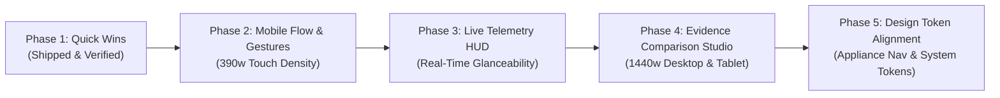

# Print Lab UX/UI Roadmap (2026–2027)

**Date:** 2026-10-27  
**Status:** In Progress (Phase 1 Delivered & Verified)  
**Reference Document:** `docs/blueprint/Print-Lab-Blueprint.md`  
**Figma Canvas:** `https://www.figma.com/design/ZDNyoPD0ZQRLEWw6NtmFPi` (Boards 01–10)  
**Implementation Surface:** `LocalAI` frontend (`Projects › Print lab`) / `print-lab` CLI & daemon

---

## 1. Vision & Architectural Contract

The Print Lab interface unites physical rapid-prototyping telemetry with disciplined scientific hypothesis tracking. Operators evaluate 3D print specimens using mobile smartphones directly at the printer bed, while reviewing macro photographic evidence, sliced parameter deltas, and cross-run trends on desktop workstations.

### Architectural Constraints
1. **Single App Shell**: No competing application chrome; Print Lab is integrated natively under `Projects › Print lab` in Local AI.
2. **Strict Token System**: All font sizes and radii must use shared `--ds-*` tokens (`tests/budgets.test.cjs`). No hardcoded pixel font sizes or border radii.
3. **Budget Guardrail**: `app.css` is held strictly under its gzipped budget threshold (46 KB). Modules are loaded on-demand (`print-lab.js`, `print-lab-observe.js`, `print-lab-photos.js`).
4. **Accessible First**: WCAG 2.2 AA compliant, minimum 44px tap targets for active controls, full keyboard traversal, polite screen-reader announcements, and zero preselected inputs.

---

## 2. Phased Roadmap

### Phase 1: Interaction Foundations *(Shipped & Verified)*
- [x] **Mobile Bottom Sheet Grab Handle**: Native iOS grab pill (`.lab-sheet::before`) on `max-width: 640px` viewports in `app/public/app.css`.
- [x] **3x2 Touch-Chip Matrix**: Transformed 6-item radio lists into compact 3x2 grid cards (`min-height: 44px`), reducing mobile observation sheet scroll height by ~65%.
- [x] **Progress Bar Glanceability**: Heightened `.lab-live__bar` to 14px with `font-variant-numeric: tabular-nums` to eliminate jitter during real-time countdowns.
- [x] **Spool Spine Contrast Clamp**: Clamped `--spine` luminance with `color-mix()` and an inset highlight border to ensure contrast on white, neon, and dark spools.
- [x] **Automated Verification**: Passed all 976 unit tests, 6 budget scale tests, and full Playwright iPhone/Desktop test suites in `tests/print-lab-ui.mjs`.

---

### Phase 2: Mobile Information Density & Field Workflow (Phone 390w)
*Target: Phone-in-hand field operations at the printer bed (Figma Boards 05, 06).*

1. **Sticky Jump Anchors & Context Sub-Bar**:
   - Floating header pill bar with anchor jump targets: `Needs You (3)`, `Live Print`, `Earlier (14)`.
   - Compact sync pulse indicator showing WebSocket/poll freshness without page reload.
2. **Touch-Gesture Evidence Viewer (`.lab-viewer`)**:
   - Add native pinch-to-zoom and horizontal swipe navigation for specimen photos in `app/public/print-lab-photos.js` (replacing reliance solely on chevron buttons).
   - Double-tap to toggle 100% 1:1 pixel inspection crop.
3. **Specimen Ribbon Scroll-Snap & Edge-Fade**:
   - Add CSS scroll-snap and progressive edge-fade gradients to horizontal thumbnail ribbons (`.lab-thumbs`) to hint at off-screen photos without cutting off awkward half-thumbnails.
4. **Offline & Pending Receipt Drawer**:
   - Surface an expandable bottom tray showing queued phone requests (`Waiting for Mac: 2`) with optimistic draft caching and clear conflict rollback messages.

---

### Phase 3: Real-Time Telemetry & Camera Glanceability (Phone + Desktop)
*Target: Continuous print monitoring and environmental awareness (Figma Board 05).*

1. **Printer HUD & Thermal Indicators**:
   - Add nozzle and bed temperature badges (`220°C / 60°C`) alongside the live progress bar in `.lab-live`.
   - Display layer progression (`Layer 42 / 185`) and layer-time pacing metrics derived from Bambuddy/Pi Hub bridge data.
2. **Camera Streaming & Connection States**:
   - Replace static text with semantic status chips: `Live Stream`, `Buffering (10s)`, `Pi Hub Asleep`, or `Offline`.
   - Add tap-to-expand modal for live camera feed with an optional grid overlay for visual bed leveling inspection.
3. **Checklist State Transitions**:
   - Smooth animated tick state on pre-print checklist items with persistent local storage per device.

---

### Phase 4: Side-by-Side Evidence Studio & Wipe Comparison (Desktop 1440w & Tablet)
*Target: Defect analysis, specimen ranking, and physical verification (Figma Boards 01, 02, 03).*

1. **Synchronized Dual-Pane Pan & Zoom (`.lab-compare`)**:
   - Synchronous cursor/drag tracking across specimen A and reference B to spot surface artifacts and layer inconsistencies.
   - Dual-tab selector to compare identical plate positions (e.g. `Run 008-01 Tab 5A` vs `Run 007-01 Tab 5A`).
2. **Interactive Wipe Curtain Slider**:
   - Implement an interactive drag handle on `.lab-wipe` (currently static side-by-side or stacked) allowing users to wipe between the reference specimen and current print.
3. **Parameter Reconciliation Table**:
   - Three-column visual breakdown: **Requested** vs **Sliced** vs **Observed** (e.g., speed `250 mm/s` requested → `147 mm/s` realized due to volumetric flow limit).
4. **AI Observation Confidence Badges**:
   - Display AI detection confidence (`94% clean`, `83% faint banding`) with visual hierarchy distinguishing confirmed observations from pending review items.

---

### Phase 5: Design Token Convergence & DS Alignment
*Target: Cross-suite design coherence and testing infrastructure (Figma Boards 09, 10).*

1. **Token Unification with `<appliance-nav>`**:
   - Ensure all Print Lab typography, line-heights, and elevation shadows match the shared Local AI design system scale (`--ds-fs-*`, `--ds-r-*`, `--ds-line-*`).
2. **High-Contrast & Reduced-Motion Polish**:
   - Add explicit high-contrast mode borders for accessibility validation.
   - Guard all transitions (sheet slide-in, progress track expansion, wipe sliders) with `@media (prefers-reduced-motion: reduce)`.
3. **Automated Visual Regression in CI**:
   - Add Playwright visual snapshot tests for 390w (iPhone 15) and 1440w (Desktop) to prevent regressions against Figma board baselines.

---

## 3. Prioritization Matrix

| Initiative | Phase | Impact | Complexity | Target Surface |
|---|---|---|---|---|
| **Sticky Jump Anchors & Context Sub-Bar** | Phase 2 | High | Low | Mobile (390w) |
| **Touch Pinch & Swipe on Viewer** | Phase 2 | High | Medium | Mobile / Tablet |
| **Edge-Fade & Scroll-Snap Ribbons** | Phase 2 | Medium | Low | Mobile (390w) |
| **Printer HUD (Temps + Layers)** | Phase 3 | High | Medium | Mobile + Desktop |
| **Camera State Badge & Expand** | Phase 3 | Medium | Low | Mobile + Desktop |
| **Dual-Pane Synchronized Zoom** | Phase 4 | High | High | Desktop (1440w) |
| **Interactive Wipe Curtain Slider** | Phase 4 | High | Medium | Desktop (1440w) |
| **Parameter Delta Table** | Phase 4 | Medium | Low | Desktop (1440w) |
| **Token Audit & Automated Visual Diffs**| Phase 5 | High | Medium | Cross-Platform |
